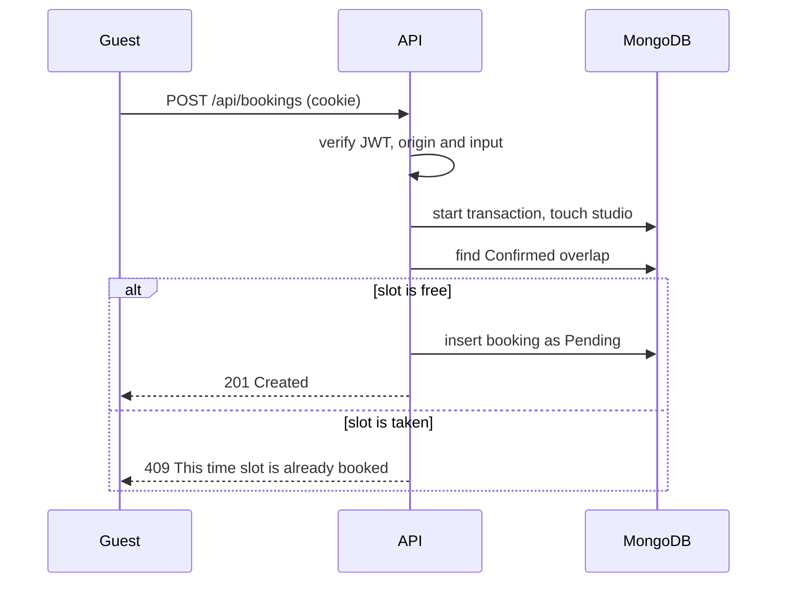

<a id="top"></a>

<div align="center">


<br />

<h1>🎛️ StudioSpace API</h1>

<p>
  <a href="https://studiospace-creators.vercel.app/"></a>
  &nbsp;
  <a href="https://github.com/SamaunRezvi/assignment_eight_c"></a>
  &nbsp;
  <a href="#about-the-project"></a>
  &nbsp;
  <a href="#api-reference"></a>
  &nbsp;
  <a href="#getting-started"></a>
</p>

<h2>Bookings that never collide.</h2>

<p>The REST API behind StudioSpace: studios, bookings, reviews, receipts and a security-first request pipeline.</p>

<p><sub><strong>HTTPONLY JWT</strong> &nbsp; · &nbsp; <strong>TRANSACTIONAL BOOKINGS</strong> &nbsp; · &nbsp; <strong>PDF RECEIPTS</strong> &nbsp; · &nbsp; <strong>ZOD VALIDATION</strong></sub></p>

</div>

<br />

## About the Project

**This is the Express API for [StudioSpace](https://studiospace-creators.vercel.app/), a peer-to-peer marketplace where creators rent photo studios, film stages, podcast lounges, music suites and art workshops by the hour.**

It owns every business rule: who may edit a studio, how a booking moves from Pending to Completed, and how overlapping
sessions are rejected. The [Next.js client](https://github.com/SamaunRezvi/assignment_eight_c) proxies `/api/*` to this
service so the authentication cookie stays first-party.

## Key Features

1. **Studios with search.** Create, read, update and delete listings with keyword, category, city, price and capacity filters, sorting and pagination. Only the host can change or remove a listing.
2. **HTTPOnly-cookie JWT.** Every mutation requires a valid, signed token cookie (pinned algorithm, issuer and audience) and answers `401 Unauthorized` without one. The owner is always taken from the token, never from the request body.
3. **Double-booking prevention.** Bookings run inside a MongoDB transaction that checks time overlap against **Confirmed** slots. Concurrent confirmations are serialised, so exactly one wins and the rest receive a clear `409` message.
4. **Booking lifecycle.** Pending, Confirmed, Completed and Cancelled, with separate rules for guests (cancel pending) and hosts (confirm, decline, complete, cancel).
5. **PDF receipts.** Confirmed and completed bookings can be downloaded as a branded PDF invoice, available only to the guest and the host.
6. **Reviews, wishlist and dashboard.** One review per user with automatic rating aggregation, idempotent saved studios, and host and guest summaries built with aggregation pipelines.
7. **Image upload proxy.** Uploads are checked against real file signatures and a 5 MB limit before being forwarded to imgbb, which keeps the API key off the browser.

## How a Booking Is Protected



<br />

## Tech Stack

<div align="center">


</div>

<br />

| Technology        | Responsibility                                                  |
| :---------------- | :-------------------------------------------------------------- |
| Express 5         | HTTP routing and middleware                                     |
| TypeScript        | Strict types across every layer                                 |
| MongoDB driver    | Collections, indexes, aggregations and transactions             |
| Zod               | Request validation and environment validation                   |
| jose              | JWT verification from the HTTPOnly cookie                       |
| Helmet, CORS      | Security headers and an origin allow-list                       |
| express-rate-limit| Global, mutation, upload and newsletter rate limits             |
| PDFKit            | Receipt generation                                              |
| Vitest            | Unit tests and in-memory replica-set integration tests          |
| Render            | Hosting                                                         |

### Project structure

```
src/
  config/        environment validation, database connection and indexes
  middleware/    authentication, CSRF origin guard, rate limiting, error handling
  modules/       studios, bookings, reviews, wishlist, dashboard, uploads, newsletter
  types/         shared domain types
  utils/         ApiError, ObjectId parsing, regex escaping, response helpers
scripts/seed.ts  demo data
tests/           unit and integration tests
```

Each module separates its schema (validation), service (business rules), controller and routes.

<br />

## API Reference

Base path: `/api`. 🔒 means a valid authentication cookie is required.

| Method | Path | Access | Description |
| :----- | :--- | :----- | :---------- |
| GET | `/health` | Public | Liveness check |
| GET | `/studios` | Public | List with `q`, `category`, `city`, `minPrice`, `maxPrice`, `capacity`, `sort`, `page`, `limit` |
| GET | `/studios/featured` | Public | Top-rated studios (`limit`, default 6) |
| GET | `/studios/cities` | Public | Distinct cities for filters |
| GET | `/studios/:id` | Public | Studio details |
| GET | `/studios/mine` | 🔒 | Studios owned by the current user |
| POST | `/studios` | 🔒 | Create a studio |
| PUT | `/studios/:id` | 🔒 owner | Update a studio |
| DELETE | `/studios/:id` | 🔒 owner | Delete a studio and cancel its open bookings |
| GET | `/studios/:id/reviews` | Public | List reviews |
| POST | `/studios/:id/reviews` | 🔒 | Add a review (one per user) |
| DELETE | `/reviews/:id` | 🔒 author | Remove a review |
| GET | `/bookings/availability?studioId=&date=` | Public | Confirmed slots for a day |
| POST | `/bookings` | 🔒 | Request a booking (status `Pending`) |
| GET | `/bookings/mine` | 🔒 | Bookings made by the current user |
| GET | `/bookings/hosted` | 🔒 | Requests for the user's studios |
| PATCH | `/bookings/:id/status` | 🔒 | Confirm, complete or cancel (rules by role) |
| GET | `/bookings/:id/invoice` | 🔒 | PDF receipt for confirmed or completed bookings |
| GET | `/wishlist`, `/wishlist/ids` | 🔒 | Saved studios |
| PUT, DELETE | `/wishlist/:studioId` | 🔒 | Save or remove a studio |
| GET | `/dashboard/summary` | 🔒 | Host and guest statistics |
| POST | `/uploads` | 🔒 | Upload an image (multipart field `image`) |
| POST | `/newsletter` | Public | Subscribe an email address |

### Response format

Every endpoint answers with the same envelope, so clients can handle results and failures in one place.

```json
{ "success": true, "data": { "id": "..." } }
```

Lists add paging details, and errors carry a readable message (plus per-field details for validation failures):

```json
{ "success": true, "data": [], "meta": { "total": 0, "page": 1, "limit": 12, "totalPages": 1 } }
{ "success": false, "message": "This time slot is already booked" }
```

### Status codes you will see

| Code | Meaning |
| :--- | :------ |
| `400` | Validation failed, with the first readable message |
| `401` | Missing or invalid authentication cookie |
| `403` | Authenticated but not allowed, or the request origin is not trusted |
| `404` | Resource missing, or not visible to you |
| `409` | Conflict: slot already booked, duplicate review or invalid status change |
| `429` | Rate limit reached |

<br />

## Security Notes

- The JWT is read only from an HTTPOnly cookie and verified with a pinned algorithm, issuer and audience.
- Unsafe methods must come from an allow-listed `Origin`, which blocks cross-site writes.
- All input is validated with Zod; search text is regex-escaped and request bodies are size-limited.
- Helmet headers, layered rate limits and generic error messages in production.
- A host's email address is never returned from public endpoints, and booking ids cannot be probed (missing and not-yours look identical).
- Secrets live in environment variables. `.env*` files are git-ignored and only `.env.example` is committed.

<br />

## Getting Started

Requirements: Node.js 20 or newer and a MongoDB Atlas cluster (a replica set, so transactions work).

```bash
git clone https://github.com/SamaunRezvi/assignment_eight_s.git
cd assignment_eight_s
npm install
cp .env.example .env
npm run seed
npm run dev
```

Fill `.env` first. The API listens on `http://localhost:5000`.

| Variable                      | Purpose                                                              |
| :---------------------------- | :------------------------------------------------------------------- |
| `MONGODB_URI`, `MONGODB_DB`   | MongoDB connection string and database name                          |
| `CLIENT_ORIGIN`               | Allowed browser origin(s) for CORS and the CSRF origin check         |
| `JWT_SECRET`                  | Shared HS256 secret (32+ characters); must equal the client's `API_JWT_SECRET` |
| `AUTH_COOKIE_NAME`            | Name of the HTTPOnly cookie that carries the JWT                     |
| `IMGBB_API_KEY`               | Enables `POST /api/uploads`                                          |

| Command             | Description                                   |
| :------------------ | :-------------------------------------------- |
| `npm run dev`       | Start with live reload                        |
| `npm run build`     | Compile TypeScript to `dist/`                 |
| `npm start`         | Run the compiled server                       |
| `npm run seed`      | Load demo studios and reviews                 |
| `npm run lint`      | Check the code with ESLint                    |
| `npm run typecheck` | Type-check without emitting                   |
| `npm test`          | Run unit and integration tests                |

### Tests

The integration suite starts an in-memory MongoDB replica set and exercises the real HTTP app. It covers rejected
unauthenticated mutations, forged tokens, cross-site writes, ownership rules, regex-safe search, the full booking
lifecycle, double-booking prevention, a concurrent confirmation race, PDF access control, reviews, wishlist and
cascading deletes. GitHub Actions runs lint, type-check, tests and a build on every push.

<br />

## Project Links

| Resource          | Link                                                                                |
| :---------------- | :---------------------------------------------------------------------------------- |
| Live application  | [studiospace-creators.vercel.app](https://studiospace-creators.vercel.app/)         |
| Client repository | [SamaunRezvi/assignment_eight_c](https://github.com/SamaunRezvi/assignment_eight_c) |
| API repository    | [SamaunRezvi/assignment_eight_s](https://github.com/SamaunRezvi/assignment_eight_s) |

## Project Note

Built as a Programming Hero learning assignment. Demo studios, hosts and prices are fictional.

**Good to know:** The API runs on a free hosting tier. After a long idle period the first request can take up to a
minute while the service wakes up. Nothing is lost, and it responds normally right after.

<br />

<div align="center">

<p><strong>STUDIOSPACE API</strong></p>
<p><sub>BOOKINGS THAT NEVER COLLIDE</sub></p>

<a href="https://studiospace-creators.vercel.app/">Explore StudioSpace ↗</a> &nbsp; · &nbsp; <a href="#top">Back to top ↑</a>

</div>
